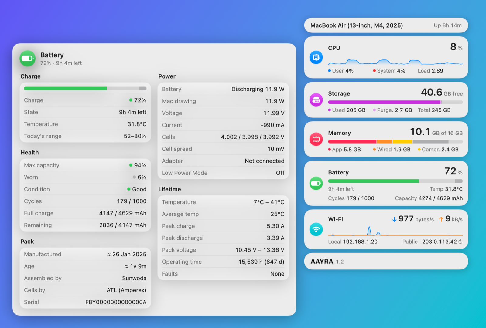
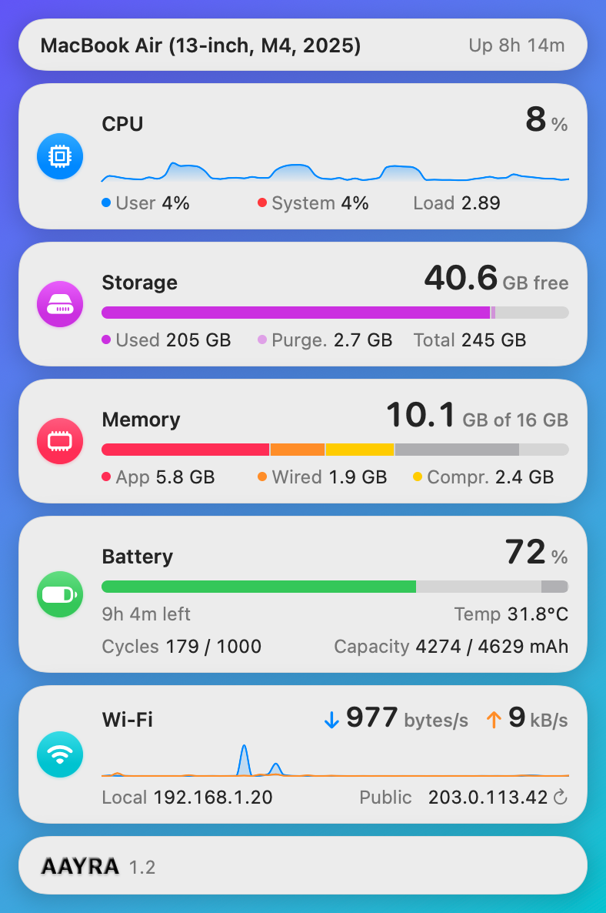
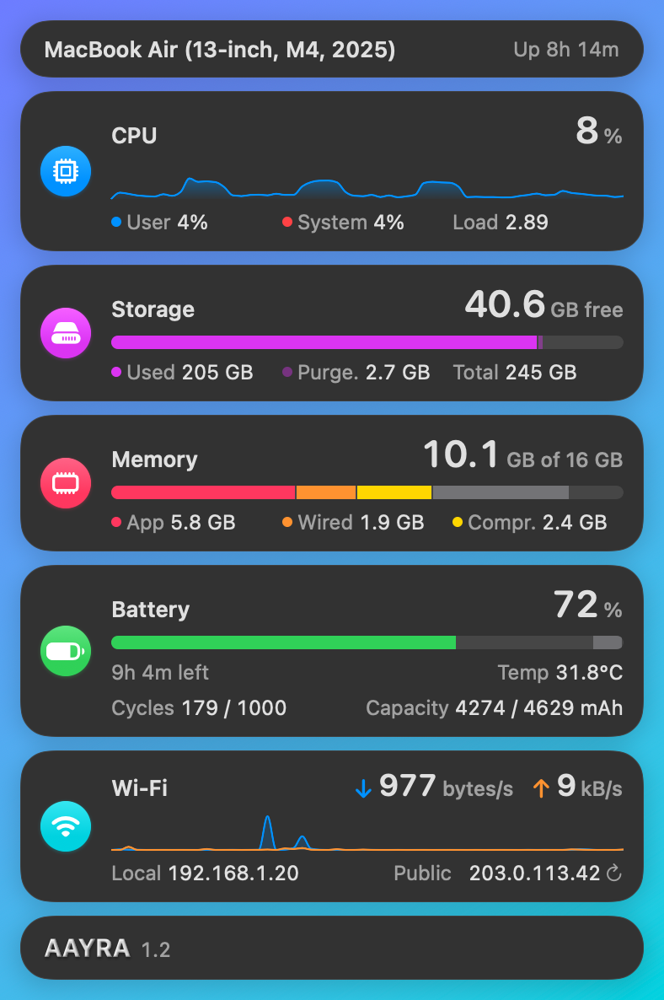
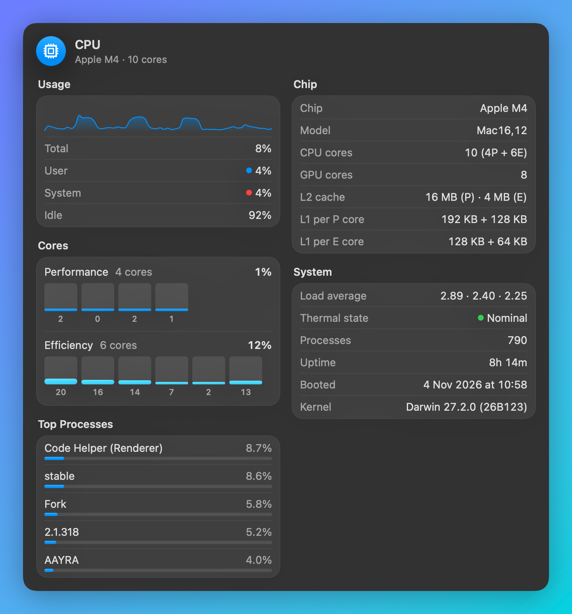
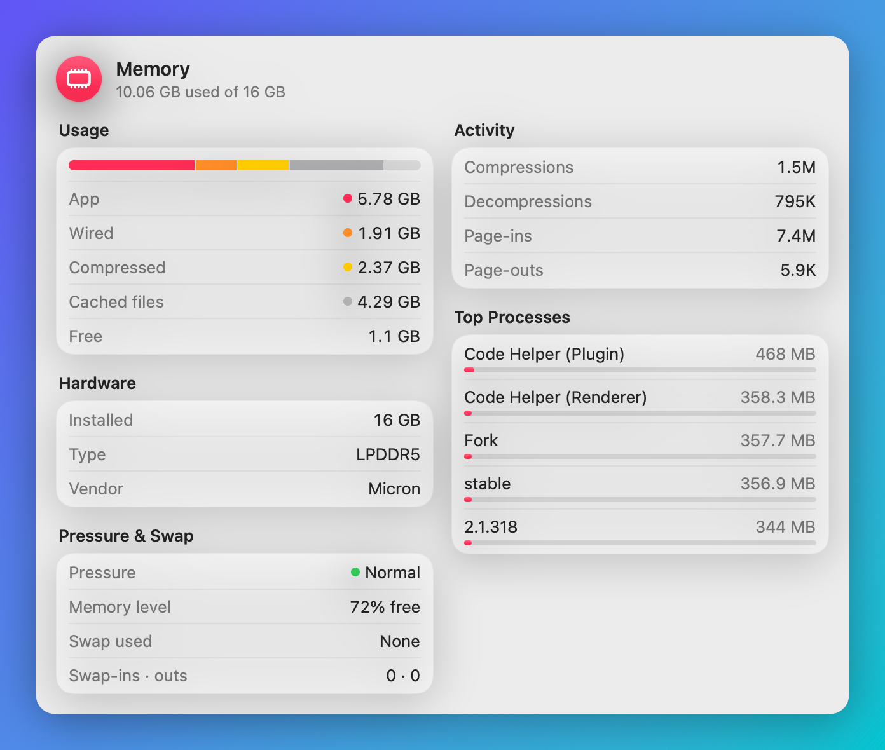
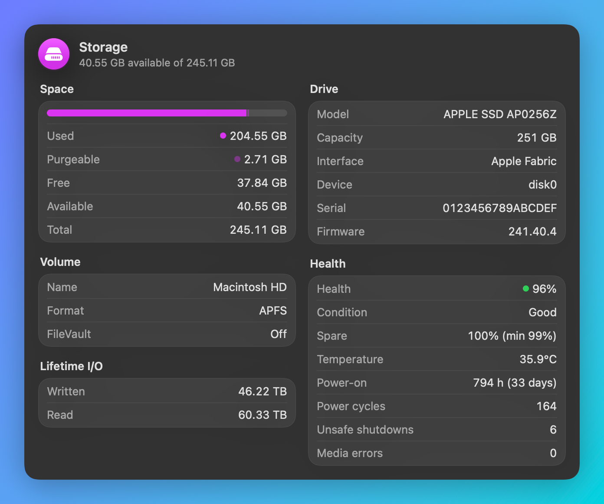
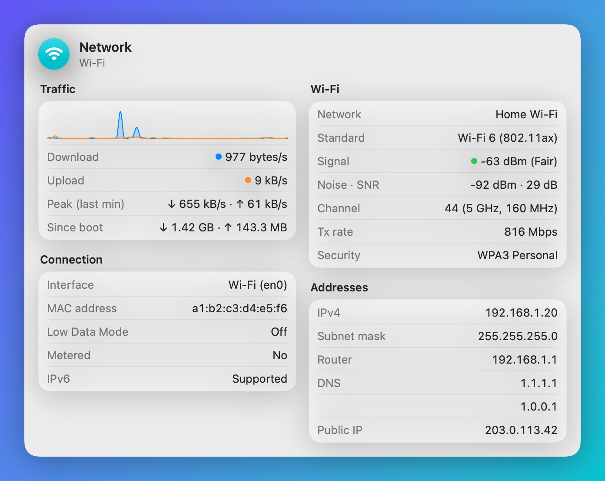
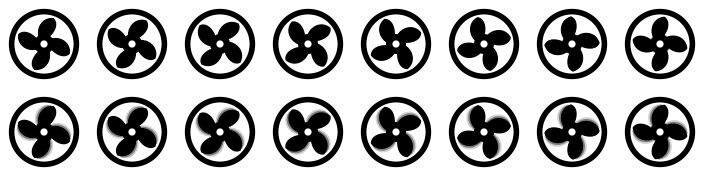

# AAYRA

**A tiny menu bar system monitor for macOS.** A turbine in the menu bar spins faster as your CPU works harder. Click it for a dashboard of CPU, storage, memory, battery and network, and click any card for the full details.

Native Swift and SwiftUI · Apple Silicon · macOS 15 or later · under 1 MB

<picture>
  <source media="(prefers-color-scheme: dark)" srcset="docs/screenshots/hero-dark.png">
  
</picture>

## Highlights

- 🌀 **Live turbine in the menu bar.** It spins slowly when the Mac is idle and speeds up with CPU load, adding motion blur above 80 %. With Reduce Motion on (or the animation turned off), it shows the CPU % as text instead.
- 🗂 **Floating dashboard.** Cards float under the menu bar like Notification Center, on Liquid Glass in macOS 26 and later. Each card shows one big number with a bar or live chart.
- 🔎 **Details on click.** Click a card and a two-column detail panel opens beside it, on whichever side has room. The numbers update every second, and you can select and copy any value.
- 🔋 **Deep battery info.** Health and condition (matching System Settings), cycles, full-charge vs design capacity, live watts, voltage and current, per-cell voltages, adapter, and lifetime records (temperature range, peak currents, operating hours). It also shows who assembled the pack and who made the cells (e.g. Sunwoda / ATL), plus the estimated manufacture date and age.
- 💾 **SSD health.** NVMe SMART data: health %, spare capacity, temperature, power-on hours, unsafe shutdowns, media errors, and total data written and read.
- 🧠 **CPU and memory.** Usage history, per-core load grouped by Performance and Efficiency cores, chip and cache details, thermal state, and top processes by CPU and by memory. Memory shows app / wired / compressed / cached, pressure and swap.
- 🌐 **Network.** Live ↓/↑ speed chart, Wi-Fi name, signal, noise and SNR, channel and band, standard, security, local and public IP (click to copy), router, DNS and MAC.
- ⚙️ **Settings.** Launch at Login, icon animation and CPU % in the menu bar, which cards to show, refresh rate (1, 2 or 5 s), temperature unit, and an opt-out for the public IP lookup.
- 🪶 **Light.** About 2–4 % CPU while idling in the menu bar, and the whole app is under 1 MB.

## Screenshots

### Dashboard

| Light | Dark |
|:---:|:---:|
|  |  |

### Detail panels

| CPU | Memory |
|:---:|:---:|
|  |  |
| **Storage** | **Network** |
|  |  |

### Menu bar turbine



The animation frames, sharp (top row) and with motion blur under heavy load (bottom row). The icon is a template image, so it follows light, dark and tinted menu bars.

> The screenshots are rendered by the app's debug renderer. In the real app the cards are Liquid Glass over your wallpaper. Serial numbers, MAC and IP addresses are replaced with placeholders.

## Using it

| Action | How |
|---|---|
| Open the dashboard | Click the turbine in the menu bar |
| Show details | Click any card. Click it again, or anywhere else, to close |
| Copy an IP address | Click it (it turns bold for a moment) |
| Settings | Gear button in the footer, ⌘, or right-click the turbine |
| Close | Click outside, press Esc, or click the turbine |
| Quit | Power button in the footer, ⌘Q, or right-click the turbine |

## Build and run

```bash
./build-app.sh --open      # builds AAYRA.app here and launches it
```

Move `AAYRA.app` to `/Applications` before turning on Launch at Login. The app icon is drawn in code. To change it, edit `scripts/make-icon.swift` and run `swift scripts/make-icon.swift`.

### Debug helpers

These are only included in debug builds, which keeps the release app small:

```bash
swift build
BIN="$(swift build --show-bin-path)/AAYRA"
"$BIN" --dump              # print one round of readings, to compare with system tools
"$BIN" --render <dir>      # write PNG previews (these screenshots); AAYRA_RENDER_SECONDS=60 for fuller charts
```

`AAYRA.app/Contents/MacOS/AAYRA --show-panel` launches the release app with the panel open.

## Privacy and notes

- **Network use.** The only network request is the public IP lookup at `https://api.ipify.org`. It runs when the panel opens, is cached for 5 minutes, and can be turned off in Settings.
- **Wi-Fi name.** macOS only reveals the Wi-Fi name to apps with Location Services access, so AAYRA asks once. Nothing is recorded or sent.
- **No CPU temperature.** Apple Silicon only exposes it through private APIs. Battery and SSD temperatures are shown.
- **Battery health** is read from `system_profiler`, so it matches System Settings. The pack assembler comes from the serial-number prefix, and the cell maker from the battery's own manufacturer data.
- **CPU cost.** Each turbine frame makes macOS re-snapshot the menu bar item, so the frame rate is capped at 4–15 fps.

## Versions

- **1.2.** Floating dashboard with big numbers, click-to-open detail panels, Settings window, SSD SMART health, deep battery details, redesigned per-core view, Control Center–style visuals.
